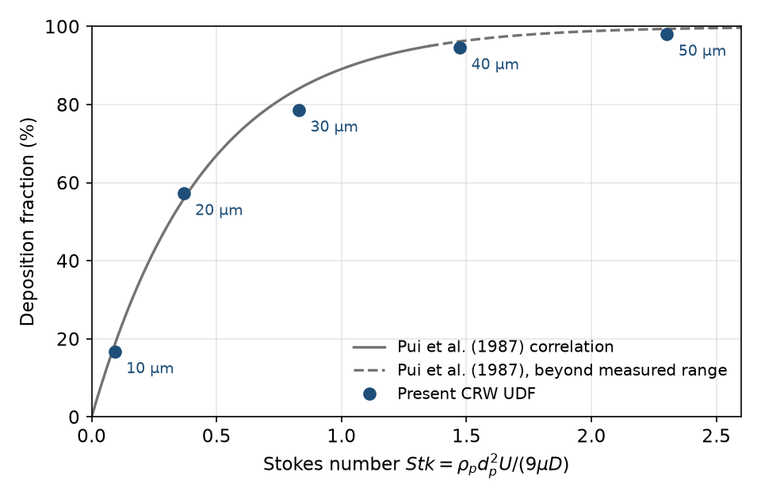

# Continuous Random Walk (CRW) Particle Dispersion UDF for ANSYS Fluent

ANSYS Fluent user-defined function (UDF) implementing the continuous random
walk model of [Dehbi (2008)](https://doi.org/10.1016/j.ijmultiphaseflow.2008.03.001),
applied to aerosol deposition in a 90° pipe bend, with a technical report, the
deposition data and analysis scripts.

**Author:** Sina Karbakhsh Ravari, Shiraz University ·
ORCID [0009-0003-6017-8628](https://orcid.org/0009-0003-6017-8628)<br>
**Project supervisor:** Dr. Ebrahim Ghahramani<br>
**Technical report:** [Markdown](report/crw-dehbi2008-technical-report.md) ·
[PDF](report/crw-dehbi2008-technical-report.pdf)

## Overview

Discrete random walk models assume locally isotropic turbulence and
over-predict the deposition of low-inertia particles in wall-bounded flows
(Dehbi, 2008). The UDF integrates a normalised Langevin equation for the fluid
velocity seen by each particle and couples it to Fluent's discrete phase model
through a body force. In the present implementation, the anisotropic near-wall
statistics and the wall-normal drift correction of Dehbi (2008) act only in
wall-adjacent cells; all other cells use isotropic statistics without drift
(see [Limitations](#limitations)).

## Implementation

- **Langevin equation:** semi-implicit Euler–Maruyama scheme for the
  normalised fluid velocity fluctuation.
- **Near-wall branch (wall-adjacent cells):** DNS-based rms profiles and the
  Kallio–Reeks time scale in a body-fitted frame, with a wall-normal drift
  correction.
- **Bulk branch (all other cells):** isotropic statistics,
  τ<sub>L</sub> = (2/C<sub>0</sub>) k/ε with C<sub>0</sub> = 14; the
  ∇k drift term is omitted.
- **Coupling:** drag of the velocity fluctuation as a DPM body force
  (Schiller–Naumann factor).
- **Wall and time step:** particles are stopped at the first wall contact; the
  time step is at most min(10⁻⁶ s, 0.1 τ<sub>p</sub>).

The equations, with source-line references, are given in Section 3 of the
report.

## Results

Air at 3.0 m/s in a pipe of 20 mm diameter with a 90° bend of curvature ratio
4 (Re = 4.1 × 10³); Reynolds stress model with enhanced wall treatment on a
5.3 × 10⁶-cell hexahedral mesh (ANSYS Fluent 2024 R2); 10,000 particles per
size class, density 1000 kg/m³ as specified in the UDF header (the archived
injection settings name a denser material; report, Sections 4 and 6). The
Stokes number is
Stk = ρ<sub>p</sub> d<sub>p</sub>² U / (9 μ D), and the deposition fraction
is counted over the whole domain.

| Particle diameter (µm) | Stokes number | Deposition fraction (%) |
| ---: | ---: | ---: |
| 10ᵃ | 0.092 | 16.7 |
| 20 | 0.368 | 57.2 |
| 30 | 0.829 | 78.6 |
| 40 | 1.473 | 94.5 |
| 50 | 2.302 | 98.0 |

ᵃ The archived injection settings for this class record 5 µm and the material
"anthracite" (report, Section 6).

<p align="center"></p>

At equal Stokes number the results differ from the turbulent-bend correlation
of Pui et al. (1987) by −5.5 to +1.4 percentage points. At the smallest Stokes
number, however, the computed value lies above the published bend
measurements, including those at the present curvature ratio (McFarland et
al., 1997). The geometry and flow conditions differ from those of the
experiments (report, Section 4), so this is a qualitative comparison, not a
validation.

## Limitations

- The near-wall statistics and the drift correction are applied only in
  wall-adjacent cells (y⁺ ≈ 0.5–1), evaluated at the cell centroid;
  Dehbi (2008) applies them throughout y⁺ < 100.
- The ∇k drift term of the bulk branch is omitted, and the Langevin state is
  not transformed when a particle moves between the near-wall and bulk frames.
- Successive random deviates are correlated (lag-1 autocorrelation 0.22), so
  the random forcing varies between particles.
- Some case settings are not recorded or differ from the archived dialogs
  (report, Section 6).

## Usage

The results were obtained with ANSYS Fluent 2024 R2 on Windows, with the UDF
compiled from the Visual Studio command prompt
([`figures/setup/udf-compilation.png`](figures/setup/udf-compilation.png)).
The UDF is written for three-dimensional cases.

1. Solve the steady flow with the Reynolds stress model and enhanced wall
   treatment.
2. Allocate 6 user-defined memory locations and 8 DPM user scalars.
3. Compile and load `udf/crw_dehbi2008_rev10.c`.
4. After the flow has converged, execute `init_wall_udm` (Execute On Demand);
   repeat this whenever the flow field or the mesh changes.
5. Disable the built-in turbulent dispersion model. Hook `crw_langevin_force`
   (DPM body force) and `crw_adaptive_dt` (DPM time step), and set the DPM
   condition of the wall zones to `dehbi_wall_bc`.
6. Track the particles with a maximum number of steps large enough for every
   particle to escape or deposit (more than 10⁵ steps at a time step of
   10⁻⁶ s). The deposition fraction is the number of "aborted" particles
   divided by the number tracked.

## Reproducibility

The Fluent case, data and mesh files are not included; the settings are
documented in the report and in [`figures/setup/`](figures/setup/). The random
numbers are generated from particle memory addresses and particle time, so
repeated runs are expected to agree statistically, not particle by particle.
The figure and the random-number-generator test are reproduced with:

```
python3 -m venv .venv
. .venv/bin/activate
pip install -r tools/requirements.txt
python tools/plot_deposition.py
gcc -std=c99 -O2 -o rng_check tools/rng_check.c -lm
./rng_check
```

## Repository structure

- `udf/`: UDF source (revision 10, used for the reported results)
- `report/`: technical report (Markdown and PDF)
- `data/`: deposition fractions from the Fluent DPM summaries
- `figures/`: geometry, meshes, wall y⁺, residuals and results;
  `figures/setup/` holds the Fluent dialogs and DPM summaries
- `tools/`: plotting script and random-number-generator test

## Citation and licence

Please cite this repository using [`CITATION.cff`](CITATION.cff). The code is
released under the [MIT License](LICENSE). ANSYS and Fluent are trademarks of
ANSYS, Inc.; the screenshots of the software document the case settings.
