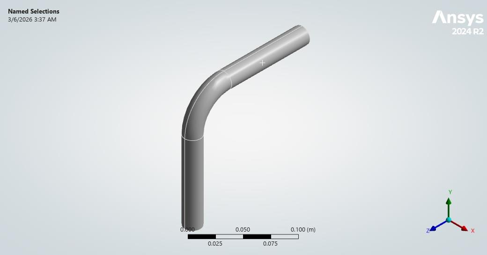
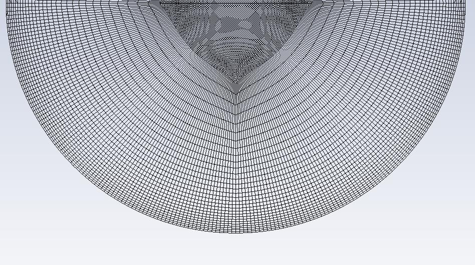
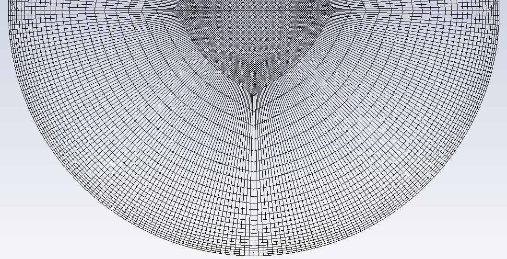
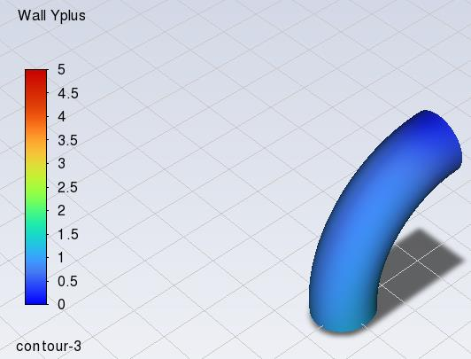
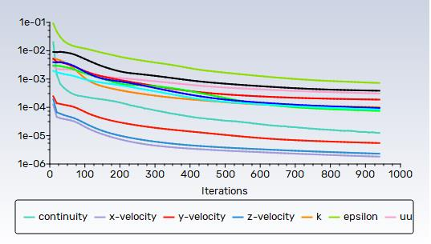
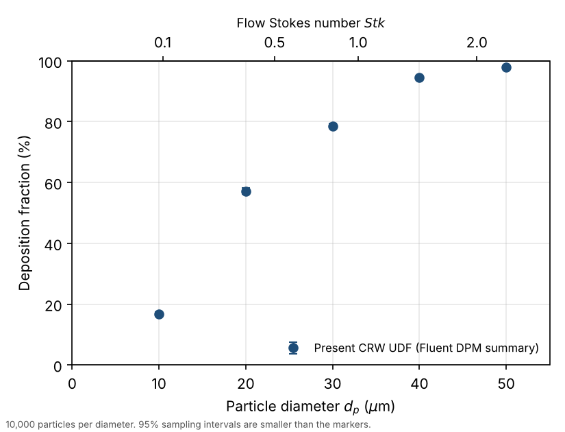
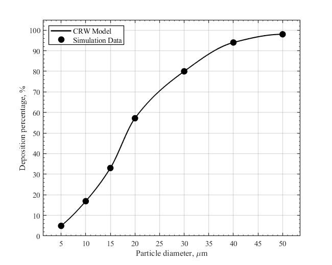

## Revision note

Revision 1 of this report (March 2026) is kept unchanged in
[`original/report-dehbi-v1-2026-03.pdf`](original/report-dehbi-v1-2026-03.pdf).
Revision 2 uses the same simulations, settings and results; no simulation was
re-run. It changes the report as follows:

1. The model equations are written out as they are implemented in
   [`udf/crw_dehbi2008_rev10.c`](../udf/crw_dehbi2008_rev10.c), with source
   line references. Revision 1 described the time integration as forward
   Euler; the code uses a semi-implicit scheme (Section 5.2).
2. The deposition fractions are tabulated from the Fluent DPM summaries that
   were already reproduced in Appendix B of revision 1.
3. Three statements of revision 1 are withdrawn because the evidence does not
   support them:
   - that the results show "excellent agreement" with the benchmark
     (no independent comparison was made, Section 6.3);
   - that the refined mesh achieved "true mesh independence" (no grid study
     was recorded, Section 3);
   - that the drift term is driven by Reynolds-stress gradients computed by
     Fluent and that mesh refinement improved results by resolving those
     gradients. The UDF does not use Reynolds-stress gradients: the
     wall-normal drift is the analytical derivative of a fitted rms profile,
     evaluated with $u_\tau$ and $y^+$ of the wall-adjacent cell (Section 5.3).
4. Revision 1 stated that the case replicates the experiment of Pui et al.
   (1987). It does not (Section 2).
5. A code review of the UDF is added (Section 7). It identifies three
   implementation issues that affect the physics. They are documented, not
   corrected, because the reported results were produced with the code as it
   stands.

## 1. Objective

The study aims to reproduce the 90° pipe-bend deposition case of Dehbi
(2008), who coupled a RANS flow solution with a continuous random walk (CRW)
model based on a normalised Langevin equation. Discrete random walk (DRW)
models sample velocity fluctuations from locally isotropic turbulence. In
inhomogeneous near-wall turbulence this produces a spurious drift of
low-inertia particles towards the wall, a violation of the well-mixed
condition, so deposition of small particles is over-predicted. Dehbi's model
uses anisotropic near-wall velocity statistics and a drift term proportional to
the wall-normal gradient of the rms velocity to restore the well-mixed
condition.

The objectives were:

1. Compute the turbulent flow in the bend with the Reynolds stress model (RSM).
2. Implement the CRW–Langevin model as a compiled ANSYS Fluent UDF that
   replaces the built-in DRW model.
3. Compute the deposition fraction for particle diameters of 5 to 50 µm and
   compare it with Dehbi (2008) and the experiments of Pui et al. (1987).

## 2. Geometry and flow conditions

*Table 1. Geometry and flow conditions.*

| Quantity | Value | Source |
| --- | --- | --- |
| Pipe diameter $D$ | 0.02 m | revision 1, Sec. 2 |
| Bend curvature ratio $R/r$ | 4 ($R$ = 0.04 m) | revision 1, Sec. 2 |
| Straight inlet / outlet sections | 5$D$ (0.10 m) each | revision 1, Sec. 2 |
| Fluid | air, $\rho$ = 1.225 kg m⁻³, $\mu$ = 1.81 × 10⁻⁵ Pa s | revision 1, Sec. 4.1 |
| Inlet | uniform velocity $U$ = 3.0 m s⁻¹; inlet turbulence not recorded | revision 1, Sec. 4.1 |
| Reynolds number $Re = \rho U D/\mu$ | 4.06 × 10³ (revision 1 states 4080) | computed |
| Friction Reynolds number $Re_\tau = u_\tau r/\nu$ | ≈ 140, with $u_\tau \approx 0.21$ m s⁻¹ from the Blasius friction factor | estimated |
| Outlet | pressure outlet, 0 Pa gauge | revision 1, Sec. 4.1 |
| Walls | stationary, no slip | revision 1, Sec. 4.1 |

*Figure 1. Computational domain: 90° bend with straight inlet and outlet sections.*

**Difference from the benchmark experiment.** Revision 1 stated that the
domain "strictly replicates" the experiment of Pui et al. (1987). The turbulent
case of that experiment is reported as a tube of diameter 8.51 mm, curvature
ratio 5.6 and $Re$ = 10,000 (as summarised by Sakib et al., 2023). The present
case ($D$ = 20 mm, $R/r$ = 4, $Re \approx 4.1 \times 10^3$) differs in all
three. In addition, a 5$D$ inlet section with a uniform inlet velocity does not
produce fully developed pipe flow at the bend. Deposition in bends correlates
mainly with the Stokes number, so a comparison with the benchmark is meaningful
only at matched $Stk$, and the effect of the different $Re$ and curvature ratio
must be discussed. The flow conditions of the Dehbi (2008) bend case were not
available to the author for this revision and must be checked against the
paper.

**Low-Reynolds-number consequence.** At $Re_\tau \approx 140$, $y^+ = 100$
lies about 7 mm from the wall, 70 % of the pipe radius. The near-wall branch of
the model (Section 5.3) is therefore intended to cover most of the cross-section,
and its rms profiles, fitted to channel-flow DNS, are applied close to the
limit of their range.

## 3. Mesh

The domain was meshed with structured hexahedral cells. Revision 1 gives a
first cell height of 70 µm, a wall $y^+ \approx 0.95$ (Figure 3), 30 inflation
layers with a growth ratio of 1.1, and about 5.3 × 10⁶ cells; a baseline mesh of
about 2.5 × 10⁶ cells was used first.

**Inconsistency to resolve.** Thirty layers starting at 70 µm with a growth
ratio of 1.1 have a total thickness of
$70\ \mu\text{m} \times (1.1^{30}-1)/0.1 \approx 11.5$ mm, larger than the
pipe radius of 10 mm. At least one of these three values must differ from the
mesh actually used and will be corrected from the mesh file. It is also not
recorded whether $y^+ \approx 0.95$ refers to the cell centroid, as in Fluent's
"Wall Yplus", or to the first cell height.

| Refined mesh, 5.3 × 10⁶ cells | Baseline mesh, 2.5 × 10⁶ cells |
| --- | --- |
|  |  |

*Figure 2. Cross-section of the bend. The refined mesh adds resolution in the
bend and close to the wall.*

*Figure 3. Fluent "Wall Yplus" on the bend surface (colour scale 0 to 5).*

Mesh quality histograms (orthogonal quality and skewness) are in
[`figures/mesh-orthogonal-quality.png`](../figures/mesh-orthogonal-quality.png)
and [`figures/mesh-skewness.png`](../figures/mesh-skewness.png).

**Mesh sensitivity.** Revision 1 reports that the baseline mesh gave
deposition fractions for 5 and 10 µm particles that deviated from the
benchmark, while larger particles were insensitive, and that the refined mesh
removed the deviation. The baseline-mesh deposition fractions were not
recorded. The study therefore shows that small-particle deposition is sensitive
to the near-wall mesh but does not quantify grid convergence. Because of the
issue in Section 7.1, part of this sensitivity may come from the thickness of
the single cell layer in which the near-wall model is active.

## 4. Solver settings

*Table 2. Solver and discrete-phase settings.*

| Item | Setting |
| --- | --- |
| Solver | ANSYS Fluent 2024 R2, pressure based, steady |
| Turbulence model | Reynolds stress model, linear pressure-strain, enhanced wall treatment (Figure S1) |
| Pressure–velocity coupling | SIMPLE |
| Spatial discretisation | least-squares gradients; second-order pressure; second-order upwind for momentum, $k$, $\varepsilon$ and Reynolds stresses (Figure S2) |
| Discrete phase | inert spheres, one-way coupling, steady tracking |
| Injection | surface injection at the inlet, 10,000 particles per diameter, randomised starting points (Figure S5) |
| Particle density | 1000 kg m⁻³ according to revision 1, Sec. 4.3 (to be confirmed, see below) |
| DPM tracking | accuracy control (tolerance 10⁻⁵, 20 refinements), automated Runge–Kutta / implicit scheme (Figure S4) |
| Built-in turbulent dispersion | disabled; dispersion supplied by the UDF body force |
| UDF hooks | body force `crw_langevin_force`, time step `crw_adaptive_dt`, 8 particle user scalars (Figure S3); wall boundary condition `dehbi_wall_bc`; on-demand `init_wall_udm` |
| Deposition | a particle is deposited when `dehbi_wall_bc` stops it at the wall; Fluent reports such particles as "aborted" |

*Figure 4. Scaled residuals of the continuous phase.*

The scaled residuals decreased to between about 10⁻³ ($\varepsilon$) and
2 × 10⁻⁶ over about 950 iterations and were still slowly decreasing. No
integral quantity, such as the pressure drop or the wall shear stress, was
monitored.

The Fluent dialogs reproduced in revision 1 are kept in
[`figures/setup/`](../figures/setup/): S1 viscous model
(`viscous-model.png`), S2 solution methods (`solution-methods.png`), S3 DPM
UDF hooks (`dpm-udf-hooks.png`), S4 DPM numerics (`dpm-numerics.png`),
S5 injection (`injection.png`) and S6 UDF compilation environment
(`udf-compilation.png`).

**Settings to confirm from the case file.**

1. The injection dialog (Figure S5) shows an injection named
   `particles-10micron` with a diameter of 5 × 10⁻⁶ m.
2. The particle material in Figure S5 is `anthracite`, whose Fluent default
   density is 1550 kg m⁻³, while revision 1 states 1000 kg m⁻³. If the
   default was kept, every Stokes number in Table 3 is 1.55 times larger.
3. The injection velocity in Figure S5 is 0 m s⁻¹, while revision 1 states that
   particles are released at the gas velocity. With $\tau_p \le 7.7$ ms and a
   0.10 m inlet section particles adjust to the gas velocity before the bend,
   so the effect is expected to be small.
4. With $\Delta t \le 10^{-6}$ s and a residence time of about 0.09 s, each
   particle needs about 9 × 10⁴ time steps. The DPM "maximum number of steps"
   setting must exceed this, otherwise particles are stopped early and also
   counted as "aborted".
5. Gravity and the orientation of the bend are not recorded. The settling
   velocity $g\tau_p$ is about 7.5 cm s⁻¹ at 50 µm, which over the residence
   time of about 0.09 s corresponds to a displacement of several millimetres
   in a pipe of 10 mm radius, so gravity affects the larger particles if it
   was enabled.
6. Three wall zones are present (`bend_90deg`, `wall1`, `wall2`; Figure S5).
   The deposition fraction in Table 3 counts particles stopped on any of
   them, including the straight sections, whereas the benchmark experiment
   reports deposition in the bend. Deposition per zone was not recorded.

## 5. CRW–Langevin model as implemented

Symbols: $u_\tau$ friction velocity, $\nu$ kinematic viscosity,
$y^+ = y u_\tau/\nu$, $k$ turbulent kinetic energy, $\varepsilon$ dissipation
rate, $\tau_p$ particle relaxation time, $\tau_L$ fluid Lagrangian integral
time, $\xi$ standard normal deviate. Equation numbers in square brackets are
those cited in the code comments for Dehbi (2008); they have not been checked
against the paper for this revision.

### 5.1 Particle equation of motion

Fluent integrates the particle momentum equation with the drag law selected in
the DPM dialog, computed from the mean slip velocity. That setting is not shown
in the reproduced dialogs; Fluent's default "spherical" law is the
Morsi–Alexander correlation, whereas the code comment (line 718) states that
Schiller–Naumann is the default. The difference is small at the particle
Reynolds numbers of this case ($Re_p \lesssim 1$). The UDF adds the drag of
the fluid velocity fluctuation as a body force per unit mass, computed with
the Schiller–Naumann correction (lines 644–738):

$$
\frac{F_i}{m_p} = f_D\,u'_i, \qquad
f_D = \frac{1 + 0.15\,Re_p^{0.687}}{\tau_p}, \qquad
\tau_p = \frac{\rho_p d_p^2}{18\,\mu}, \qquad
Re_p = \frac{|\mathbf{U} - \mathbf{u}_p|\,d_p}{\nu}.
$$

The fluctuation $u'_i$ is updated once per particle time step, on the call for
the first velocity component, and reused for the other two.

### 5.2 Normalised Langevin equation

The model evolves the normalised fluctuation $\eta_i = u'_i/\sigma_i$:

$$
d\eta_i = -\frac{\eta_i}{\tau_L}\,dt + A_i\,dt + \sqrt{\frac{2}{\tau_L}}\,dW_i .
$$

It is discretised semi-implicitly: the relaxation term is implicit, and the
drift and noise terms are explicit (lines 397–399, 427–429):

$$
\eta_i^{n+1} = \frac{\eta_i^{n} + \sqrt{2\,\Delta t/\tau_L}\;\xi_i + A_i\,\Delta t}{1 + \Delta t/\tau_L}.
$$

The code comments call this "implicit Euler"; it is a semi-implicit
(linearly implicit) Euler–Maruyama scheme. For $\Delta t \ll \tau_L$, which
holds here because $\Delta t \le 10^{-6}$ s, the stationary variance of $\eta$
is $1/(1 + \Delta t/2\tau_L) \approx 1$, provided the deviates $\xi$ are
independent (see Section 7.2).

### 5.3 Near-wall branch ($y^+ < 100$)

The near-wall equations are solved in a body-fitted frame (lines 225–275):
$\mathbf{e}_2$ is the inward wall normal, $\mathbf{e}_1$ the local
mean-velocity direction made orthogonal to $\mathbf{e}_2$, and
$\mathbf{e}_3 = \mathbf{e}_1 \times \mathbf{e}_2$. The rms fluctuations are
algebraic fits to channel-flow DNS data given by Dehbi (2008) [Eqs. 37–39]
(lines 131–148):

$$
\frac{\sigma_1}{u_\tau} = \frac{0.40\,y^+}{1 + 0.0239\,(y^+)^{1.496}}, \quad
\frac{\sigma_2}{u_\tau} = \frac{0.0116\,(y^+)^2}{1 + 0.203\,y^+ + 0.00140\,(y^+)^{2.421}}, \quad
\frac{\sigma_3}{u_\tau} = \frac{0.19\,y^+}{1 + 0.0361\,(y^+)^{1.322}} .
$$

The code comments attribute these fits to Dreeben and Pope (1997); that
attribution could not be confirmed and is not repeated here.

The Lagrangian time scale follows Kallio and Reeks (1989) [Eqs. 31–33]
(lines 196–214):

$$
\tau_L = \tau_L^+\,\frac{\nu}{u_\tau^2}, \qquad
\tau_L^+ =
\begin{cases}
10, & y^+ \le 5,\\
7.122 + 0.5731\,y^+ - 0.00129\,(y^+)^2, & 5 < y^+ \le 100.
\end{cases}
$$

Only the wall-normal component carries a drift term [Eq. 22]
(lines 421–422). It is reduced for inertial particles by the local Stokes
number $St = \tau_p/\tau_L$ (variable `Stk` in the code; not the same as the
flow Stokes number $Stk$ of Table 3):

$$
A_1 = A_3 = 0, \qquad
A_2 = \frac{1}{1 + St}\,\frac{\partial \sigma_2}{\partial y}
    = \frac{1}{1 + St}\,\frac{u_\tau^2}{\nu}\,\frac{d(\sigma_2/u_\tau)}{dy^+}.
$$

The derivative $d(\sigma_2/u_\tau)/dy^+$ is evaluated analytically
(lines 163–188); no gradient computed by Fluent is used. The fluctuation is
$u'_i = \eta_i \sigma_i$ in the body-fitted frame and is rotated to Cartesian
components.

### 5.4 Bulk branch ($y^+ \ge 100$)

Away from the wall the turbulence is treated as isotropic
(lines 444–474), with $\sigma = (2k/3)^{1/2}$ [Eq. 26] and

$$
\tau_L = \frac{2}{C_0}\,\frac{k}{\varepsilon}, \qquad C_0 = 14 \quad \text{[Eq. 36]}.
$$

The bulk drift term of the model, proportional to $\nabla k$ [Eq. 27], is set
to zero in this implementation. The code comment gives the reason: reading
the cell gradient of $k$ under the RSM crashed Fluent. The effect of omitting
the term was not quantified.

### 5.5 Wall data and time step

The on-demand function `init_wall_udm` (lines 498–625) stores $u_\tau$,
$y^+$ and the wall normal in user-defined memory. It computes the wall shear
stress from the tangential velocity of the wall-adjacent cell divided by the
wall distance. The particle time step is
$\Delta t = \max\left[\min(10^{-6}\ \text{s},\ 0.1\,\tau_p),\ 10^{-9}\ \text{s}\right]$,
capped by Fluent's own step (lines 765–797).

## 6. Results

### 6.1 Continuous phase

The curvature of the bend produces the expected secondary flow: the centrifugal
pressure gradient drives faster core fluid towards the outer wall and slower
near-wall fluid inwards, forming a pair of counter-rotating Dean vortices.
Revision 1 describes this flow qualitatively; no secondary-flow contours or
velocity profiles are included in either revision.

### 6.2 Deposition fraction

Table 3 lists the deposition fractions from the Fluent DPM summaries reproduced
in Appendix B of revision 1 (also in
[`data/deposition_fraction.csv`](../data/deposition_fraction.csv)). The flow
Stokes number is $Stk = \rho_p d_p^2 U/(9\mu D)$ with the values of Table 1 and
$\rho_p$ = 1000 kg m⁻³, neglecting the Cunningham correction.

*Table 3. Deposition fraction (DF) per particle diameter.*

| $d_p$ (µm) | $Stk$ | Tracked | Escaped | Deposited ("aborted") | DF (%) | Sampling standard error (%) |
| --- | --- | --- | --- | --- | --- | --- |
| 10 | 0.092 | 10,000 | 8,329 | 1,671 | 16.7 | 0.37 |
| 20 | 0.368 | 10,000 | 4,279 | 5,721 | 57.2 | 0.49 |
| 30 | 0.829 | 10,000 | 2,142 | 7,858 | 78.6 | 0.41 |
| 40 | 1.473 | 10,000 | 546 | 9,454 | 94.5 | 0.23 |
| 50 | 2.302 | 10,000 | 199 | 9,801 | 98.0 | 0.14 |

The standard error, $\sqrt{DF(1-DF)/N}$, covers only the finite number of
particles. It does not include the effects of the issues in Section 7 or of the
settings listed in Section 4.

Revision 1 (Figure 6) also shows points at 5 µm (about 5 %) and 15 µm (about
33 %). No DPM summary is available for these two diameters, so they are not
included in Table 3. Revision 1 lists six diameters in its Sec. 4.3, plots
seven, and refers to "seven distinct particle diameters (10 to 50 µm)" in its
conclusions.

*Figure 5. Deposition fraction from Table 3 against particle diameter (bottom
axis) and flow Stokes number (top axis), generated by
[`tools/plot_deposition.py`](../tools/plot_deposition.py). The 95 % sampling
intervals are smaller than the markers.*

*Figure 6. Figure 10 of revision 1, reproduced unchanged.*

### 6.3 Comparison with the benchmark

In Figure 6 the simulated points are drawn with a solid curve labelled
"CRW Model", which revision 1 describes as the numerical curve of Dehbi
(2008). The curve passes through every simulated point, including changes of
slope at 15 and 20 µm, and no experimental points are shown. The figure
therefore does not let the reader judge the agreement, and no agreement is
claimed in this revision. The comparison still to be made is:

1. Digitise the Dehbi (2008) results and the Pui et al. (1987) data, with the
   digitisation uncertainty.
2. Plot them against Table 3 as a function of $Stk$, because the flow
   conditions differ (Section 2).
3. Report the difference at each Stokes number.

## 7. Code review of the UDF

The source file was reviewed line by line for this revision. The file in this
repository is unchanged from the version used for the results above.
Revision 1 (Appendix A) refers to the source file as `lanudf.c`; the UDF names
hooked in Figure S3 match `crw_dehbi2008_rev10.c`.

### 7.1 The near-wall branch is applied only in wall-adjacent cells

`init_wall_udm` loops over wall faces and writes wall data only into the cell
adjacent to each face (`F_C0`, lines 522–618). Every other cell keeps the flag
`UDM_INIT = 0`. In `advance_langevin`, such cells fall back to the bulk branch:
lines 376–383 compute a $y^+$ from the wall distance and then overwrite it with
`BL_YPLUS_MAX + 1`.

The anisotropic statistics and the drift correction of Section 5.3 therefore
act only in the first cell layer, where $y^+$ is of order 1. All
other cells, including those between $y^+ \approx 1$ and $y^+ = 100$
(Section 2: most of the cross-section), use the isotropic, drift-free bulk
branch, which is the treatment the Dehbi model was designed to replace. Any
agreement with the benchmark obtained with this version could not be
attributed to the drift correction as described in Section 5.3.

A second limitation applies even where the branch is active: $y^+$,
$\sigma_i$, $\tau_L$ and $A_2$ are read from the cell (`C_UDMI(c, …)`,
lines 367–368, 412 and 421), so they are constant within a cell. Inside the
first cell, where deposition is decided, $\sigma_2$ is frozen at its
cell-centre value instead of falling to zero at the wall. Extending the cell
data to all cells with $y^+ \le 100$ would still give a piecewise-constant
$\sigma_2$ with jumps between cells, and the analytical drift would then not
match the profile seen by the particle.

**Correction for revision 3:** store, for every cell with $y^+ \le 100$, the
centroid and normal of its nearest wall face and $u_\tau$ there, and compute
the particle's own wall distance $y_p = (\mathbf{x}_p - \mathbf{x}_w)\cdot
\mathbf{n}_w$ at each step. Verify the result with the standard well-mixed
test: tracer particles ($\tau_p \to 0$) released uniformly in a straight pipe
must remain uniformly distributed.

### 7.2 The random-number generator produces correlated deviates

`gauss_rand` (lines 94–121) keeps no generator state. It hashes the particle's
memory address, the current particle time and a salt through one step of two
linear congruential generators and applies the Box–Muller transform. The
program [`tools/rng_check.c`](../tools/rng_check.c) runs an exact copy of the
function. Only the lowest 31 bits of each congruential step are used, so the
result is the same whether `unsigned long` has 32 bits (MSVC) or 64 bits.

*Table 4. Statistics of the UDF generator, time step 10⁻⁶ s.*

| Statistic | Ideal value | Result |
| --- | --- | --- |
| Mean, variance (one address, 2 × 10⁵ samples) | 0, 1 | +0.001, 1.003 |
| Autocorrelation, lags 1 to 5 (address 0x7ff6a1b2c3d0) | 0 ± 0.005 | +0.22, +0.06, −0.11, −0.29, −0.23 |
| Correlation between two particles at the same time | 0 ± 0.005 | between −0.65 and +0.85, depending on the address difference |
| Variance of the sum of $M$ = 1000 successive deviates divided by $M$ (six addresses) | 1 | 0.26 to 10.3 |
| As above, 2000 pseudo-random 16-byte-aligned addresses | 1 | median 0.48; 5–95 % range 0.20 to 2.7; extremes 0.08 and 60 |

The one-point statistics are correct, but successive deviates are strongly
correlated. The last row is the relevant measure for dispersion: over a time
of the order of $\tau_L$ (about 10³ steps of 10⁻⁶ s), the accumulated forcing
of a typical particle has about half the variance of independent deviates, and
across particles the ratio ranges over almost three orders of magnitude
(0.08 to 60), depending only on the particle's memory address. The effective turbulent diffusivity of the
model is therefore wrong by a factor that differs from particle to particle.
It is also not known whether Fluent reuses the same `Tracked_Particle`
structure for successive particles in steady tracking; if it does, particles
would receive nearly identical forcing sequences.

**Correction for revision 3:** give each particle its own generator state, for
example a 32-bit xorshift or SplitMix state stored in an additional particle
user scalar and seeded once at injection, and extend `rng_check` to test the
new generator over many seeds before the simulations are re-run.

### 7.3 The Langevin state changes frame between branches

In the near-wall branch $\eta$ holds components in the body-fitted frame
($\mathbf{e}_1, \mathbf{e}_2, \mathbf{e}_3$; lines 427–429). In the bulk
branch it holds Cartesian components ($x, y, z$; lines 465–467). The same
three particle variables store both (lines 478–480), and no rotation is applied
when a particle moves from one branch to the other. Streamwise, wall-normal and
spanwise components are then reinterpreted as $x$, $y$ and $z$. Because of
Section 7.1, particles near the wall cross between the branches often.

**Correction for revision 3:** store the dimensional Cartesian fluctuation and
re-normalise it in the current frame at each step,
$\eta = \mathbf{R}^{\mathsf{T}}\mathbf{u}'/\boldsymbol{\sigma}$.

### 7.4 Smaller points

1. `dehbi_wall_bc` returns `PATH_ABORT` (lines 749–752). Fluent counts these
   particles as "aborted", the same category as particles stopped for numerical
   reasons such as the step limit (Section 4). Fluent's built-in trap
   condition, or a counter in user memory, would separate the two.
2. The deposition comment (lines 741–748) states that a particle reaching a
   wall face is within one radius of the wall. Fluent detects wall contact when
   the particle centre reaches the face, so the criterion is applied at zero
   distance, not at one radius.
3. The bulk-branch comment states that omitting the $\nabla k$ drift has a
   "negligible effect on the final results". This was not tested.
4. Comments that disagree with the code: the header refers to
   "d(sigma^2)/dy" (line 10) while the code uses $d\sigma_2/dy$; line 494
   promises a "k-eps fallback" for cells away from the wall, but lines 378–382
   force the bulk branch and the computed $y^+$ is overwritten; the generator
   is described as producing "uncorrelated" numbers (lines 85–86).
5. The integration uses `TP_DT(p)` (line 359) while the update test uses the
   time since the last update (line 691); these can differ under accuracy
   control. The first step after injection always uses $u' = 0$
   (lines 679–683).
6. The code does not check that 6 user-defined memory locations and 8 particle
   user scalars are allocated; if they are not, Fluent fails at run time.
7. At $y^+ = 100$ the model switches abruptly between branches. With the
   equilibrium log-law estimates $k^+ = C_\mu^{-1/2} \approx 3.3$ and
   $\varepsilon^+ = 1/(\kappa y^+)$, $\sigma_2/u_\tau$ changes from 0.98 to
   about 1.5 and $\tau_L^+$ from 51.5 to about 20, with no drift term for
   these jumps. The bulk branch also uses the isotropic
   $(2k/3)^{1/2}$ although the RSM provides the individual normal stresses.
8. Comment FIX-10 (lines 87–90) describes the conversion of
   `TP_TIME(p)*1e9` to a 32-bit `unsigned long` as an intentional
   truncation. A floating-point value outside the range of the target type
   gives undefined behaviour in C. It does not occur here, because the
   residence time is below 4.29 s.

The code is otherwise well organised: it uses named constants for memory
indices, guards against unassigned cells at injection, has no mutable static
state, follows the C89 declaration rules required by the Fluent compiler, and
records each change (FIX-2 to FIX-19) in comments.

## 8. Conclusions

1. A CRW–Langevin dispersion model following Dehbi (2008) was implemented as a
   compiled ANSYS Fluent UDF with anisotropic near-wall statistics, a
   body-fitted frame, a Stokes-number-weighted wall-normal drift and an
   adaptive particle time step.
2. On an RSM flow field, the UDF gives deposition fractions that rise from
   16.7 % at 10 µm ($Stk$ = 0.09) to 98.0 % at 50 µm ($Stk$ = 2.3) (Table 3).
3. Deposition of 5 and 10 µm particles was sensitive to the near-wall mesh;
   the sensitivity was observed but not quantified.
4. The code review shows that, in the version used, the near-wall branch acts
   only in wall-adjacent cells and with cell-constant statistics, the random
   deviates are correlated, and the Langevin state is not rotated between
   frames. The case also differs from the
   Pui et al. (1987) experiment. The results should therefore be described as
   the output of a working implementation, not as a validation. Revision 3
   will correct the three code issues, settle the open settings, and re-run all
   diameters with a benchmark comparison at matched Stokes number.

## 9. Use of software tools

As stated in revision 1, the Cursor code editor was used during UDF
development to debug C syntax, memory-access errors and compilation problems
with Fluent's `udf.h` macros, and to tidy comments. The physical model,
equations and coupling logic were taken from Dehbi (2008).

Revision 2 of this report, the README, `tools/plot_deposition.py`,
`tools/rng_check.c` and the code review in Section 7 were drafted with the help
of an AI assistant (Claude). The author checked them against the source code,
the original Fluent output and revision 1.

## References

1. Dehbi, A. (2008). Turbulent particle dispersion in arbitrary wall-bounded
   geometries: A coupled CFD-Langevin-equation based approach.
   *International Journal of Multiphase Flow*, 34(9), 819–828.
   <https://doi.org/10.1016/j.ijmultiphaseflow.2008.03.001>
2. Pui, D. Y. H., Romay-Novas, F., & Liu, B. Y. H. (1987). Experimental study
   of particle deposition in bends of circular cross section.
   *Aerosol Science and Technology*, 7(3), 301–315.
3. Kallio, G. A., & Reeks, M. W. (1989). A numerical simulation of particle
   deposition in turbulent boundary layers.
   *International Journal of Multiphase Flow*, 15(3), 433–446.
4. Sakib, M. N., Shuvo, M. S., Rahman, R., & Saha, S. (2023). Particle
   deposition and fluid flow characteristics in turbulent corrugated pipe flow
   using Eulerian-Lagrangian approach. *Heliyon*, 9(3), e14603.
   <https://doi.org/10.1016/j.heliyon.2023.e14603>
   (cited for its summary of the Pui et al. experimental conditions).
